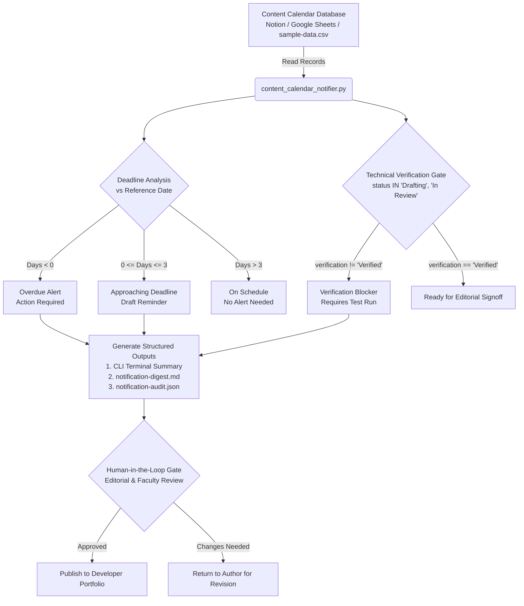

# Content Calendar Automation Workflow
**Project:** CAPSTONE 62 — AI-Powered Technical Blog Writing Series for Developers  
**Automation Engine:** Python Standard Library (`csv`, `datetime`, `json`, `argparse`)  
**Companion Script:** [`content_calendar_notifier.py`](file:///c:/Users/yohes/OneDrive/Desktop/44/capstone-62/automation/content_calendar_notifier.py)  
**Sample Dataset:** [`sample-data.csv`](file:///c:/Users/yohes/OneDrive/Desktop/44/capstone-62/automation/sample-data.csv)

---

## 1. Workflow Architecture & Visual Diagram

The content automation workflow monitors content delivery timelines, enforces technical verification gates, and delivers scheduled reminders while maintaining strict human-in-the-loop oversight.



---

## 2. Trigger and Action Descriptions

| Stage | Component | Trigger Condition | Automated Action | Governance Policy |
|---|---|---|---|---|
| **TRG-01** | **Daily Scheduler** | Time trigger (daily at 09:00 local time via cron or Windows Task Scheduler). | Ingests latest calendar CSV and parses date fields. | Read-only access; non-destructive. |
| **TRG-02** | **Overdue Detection** | `planned_date < current_date` AND `status != 'Published'`. | Generates high-priority warning flag with days overdue in summary report. | Alerts assigned author and reviewer. |
| **TRG-03** | **Approaching Deadline** | `0 <= (planned_date - current_date) <= 3 days`. | Triggers draft reminder digest with target publication date. | Author alerted to finalize draft. |
| **TRG-04** | **Verification Gate** | `status` in `['Drafting', 'In Review']` AND `verification_status != 'Verified'`. | Flags item as blocked; prevents advancing to publication queue. | **Mandatory Gate:** Unit tests and facts must be validated first. |
| **TRG-05** | **Publication Gate** | Item marked `Ready for Publish`. | Script issues audit notice requiring manual human sign-off. | **Zero Auto-Publishing:** Requires human signature in checklist. |

---

## 3. Required Data Schema & Fields

The content calendar requires the following standardized schema:

| Field Name | Type | Allowed Values / Format | Description |
|---|---|---|---|
| `id` | Integer | Positive integer (`1, 2, ...`) | Unique content item identifier. |
| `title` | String | Plain text | Full working title of the technical article. |
| `topic` | String | Plain text | Umbrella theme or category. |
| `planned_date` | Date | `YYYY-MM-DD` | Target deadline for publication. |
| `status` | Enum | `Idea`, `Drafting`, `In Review`, `Ready for Publish`, `Published` | Current stage in editorial pipeline. |
| `draft_location` | String | Relative path (e.g., `blogs/post-1.md`) | Filepath to the draft in the repository. |
| `author` | String | Name | Assigned student developer. |
| `reviewer` | String | Name | Assigned faculty or senior peer reviewer. |
| `verification_status` | Enum | `Pending Verification`, `Action Needed`, `Verified` | Technical verification gatekeeper status. |
| `priority` | Enum | `Low`, `Medium`, `High`, `Urgent` | Scheduling priority level. |

---

## 4. Example Data Records (from `sample-data.csv`)

```csv
id,title,topic,planned_date,status,draft_location,author,reviewer,verification_status,priority
1,Build Your First Python CLI Application: A Step-by-Step Guide,Python Development: Beginner to Practical,2026-10-18,Drafting,blogs/post-1-python-cli.md,Alex Chen,Prof. Sarah Jenkins,Verified,High
2,Five Common Python Errors and How to Debug Them,Python Development: Beginner to Practical,2026-10-22,Drafting,blogs/post-2-python-errors.md,Alex Chen,Prof. Sarah Jenkins,Verified,Medium
3,Writing Better Python Code with Functions and Unit Tests,Python Development: Beginner to Practical,2026-10-25,Idea,blogs/post-3-functions-testing.md,Alex Chen,Prof. Sarah Jenkins,Pending Verification,High
4,Mastering Virtual Environments and Dependency Pinning,Python Tooling and Best Practices,2026-10-16,In Review,blogs/backlog/post-venv-pinning.md,Alex Chen,Senior Peer Reviewer,Pending Verification,Urgent
5,Demystifying Python Generators and Iterators,Advanced Python Concepts,2026-10-12,Drafting,blogs/backlog/post-generators.md,Alex Chen,Prof. Sarah Jenkins,Action Needed,Low
6,Building Resilient Microservices with Python and FastAPI,Backend Engineering Series,2026-11-05,Idea,blogs/backlog/post-fastapi.md,Alex Chen,Tech Lead Mentor,Pending Verification,Medium
```

---

## 5. Error-Handling Strategy
The automation script includes comprehensive error handling:
1. **Missing Calendar File:** If the CSV path does not exist, the script raises a descriptive `FileNotFoundError` without leaving hanging threads.
2. **Malformed Date Strings:** If an author enters an invalid date format (e.g., `18/10/2026` instead of `YYYY-MM-DD`), the parser logs a clear warning to `sys.stderr` and skips that row rather than crashing the entire batch.
3. **Missing Column Headers:** The dictionary parser uses `.get(field, default_value)` for all record lookups, ensuring missing columns default safely.
4. **UTF-8 BOM Compatibility:** Uses `encoding="utf-8-sig"` to cleanly parse CSV files exported directly from Microsoft Excel or Google Sheets.

---

## 6. Verification and Testing Procedure
To verify that the automation process functions correctly on any system:

```bash
# Run the automation with simulated date 2026-10-15
python automation/content_calendar_notifier.py --date 2026-10-15
```

### Expected Output Verifications:
1. Terminal prints the formatted table identifying overdue items (ID 5) and approaching deadlines (ID 1, ID 4).
2. Generates [`notification-digest.md`](file:///c:/Users/yohes/OneDrive/Desktop/44/capstone-62/automation/notification-digest.md) with GitHub Flavored Markdown alerts.
3. Generates [`notification-audit.json`](file:///c:/Users/yohes/OneDrive/Desktop/44/capstone-62/automation/notification-audit.json) containing structured JSON records for programmatic consumption.
