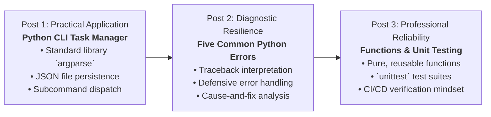

# Topic Series & Curriculum Content Plan
## Theme: Python Development — From Beginner to Practical Developer

**Series Overview:**  
This three-part technical blog series is designed specifically for Computer Science Engineering (CSE) students making the critical transition from writing short academic scripts to building robust, portfolio-worthy software applications. Each article builds incrementally upon the previous, establishing practical habits in software modularity, exception handling, and automated verification.

---

## Pedagogical Progression

---

## Detailed Post Outlines

### Post 1: Main Flagship Tutorial (~1,000 words)
- **Title:** *Build Your First Python CLI Application: A Step-by-Step Guide*
- **Target Word Count:** ~1,000 words
- **Core Pedagogical Goal:** Demystify command-line interface development by building a functional Task Manager entirely with Python's Standard Library.
- **Key Concepts Covered:**
  - Why CLI tools remain industry staples for developers and DevOps engineers.
  - Parsing terminal flags, positional arguments, and subcommands using `argparse`.
  - Storing structured application state reliably in local JSON files.
  - Designing defensive input validation and graceful failure modes.
  - Executing terminal workflows and running companion automated tests.
- **Accompanying Code Artifacts:**
  - Application Code: [`code/task_manager.py`](file:///c:/Users/yohes/OneDrive/Desktop/44/capstone-62/code/task_manager.py)
  - Test Suite: [`tests/test_task_manager.py`](file:///c:/Users/yohes/OneDrive/Desktop/44/capstone-62/tests/test_task_manager.py)

---

### Post 2: Diagnostic Guide (~650 words)
- **Title:** *Five Common Python Errors and How to Debug Them*
- **Target Word Count:** ~650 words
- **Core Pedagogical Goal:** Eliminate the fear of Python tracebacks by deconstructing the five most common exception types encountered by students.
- **Key Concepts Covered:**
  - How the Python interpreter generates tracebacks (line numbers, frames, exception types).
  - Deep-dive into 5 universal errors:
    1. `SyntaxError`: parsing failures, missing colons, mismatched delimiters.
    2. `NameError` / `UnboundLocalError`: undefined or out-of-scope identifiers.
    3. `TypeError`: illegal operations across incompatible data types.
    4. `IndexError`: out-of-bounds access on ordered sequences.
    5. `KeyError`: querying non-existent dictionary keys.
  - Practical before-and-after code snippets illustrating defensive programming patterns.
- **Accompanying Code Artifacts:**
  - Diagnostic Module: [`code/error_examples.py`](file:///c:/Users/yohes/OneDrive/Desktop/44/capstone-62/code/error_examples.py)

---

### Post 3: Software Craftsmanship Guide (~750 words)
- **Title:** *Writing Better Python Code with Functions and Unit Tests*
- **Target Word Count:** ~750 words
- **Core Pedagogical Goal:** Teach students how to structure code into deterministic, testable functions and verify them automatically using Python's built-in `unittest` module.
- **Key Concepts Covered:**
  - The Single Responsibility Principle applied to Python functions.
  - Pure functions: avoiding hidden global side effects.
  - Parameter typing, default arguments, and explicit return types.
  - Anatomy of a test case: `setUp`, test methods, and assertions (`assertEqual`, `assertRaises`).
  - Why automated testing builds developer authority on GitHub.
- **Accompanying Code Artifacts:**
  - Utility Functions: [`code/string_utils.py`](file:///c:/Users/yohes/OneDrive/Desktop/44/capstone-62/code/string_utils.py)
  - Unit Test Suite: [`tests/test_string_utils.py`](file:///c:/Users/yohes/OneDrive/Desktop/44/capstone-62/tests/test_string_utils.py)

---

## Publication & Review Schedule

| Post ID | Working Title | Target Publish Date | Drafting Status | Technical Verification | Assigned Reviewer |
|---|---|---|---|---|---|
| **POST-01** | Build Your First Python CLI Application: A Step-by-Step Guide | 2026-10-18 | Final Polish | Verified (17/17 tests passing) | Prof. Sarah Jenkins |
| **POST-02** | Five Common Python Errors and How to Debug Them | 2026-10-22 | Final Polish | Verified (5/5 errors caught) | Prof. Sarah Jenkins |
| **POST-03** | Writing Better Python Code with Functions and Unit Tests | 2026-10-25 | Final Polish | Verified (8/8 tests passing) | Prof. Sarah Jenkins |
