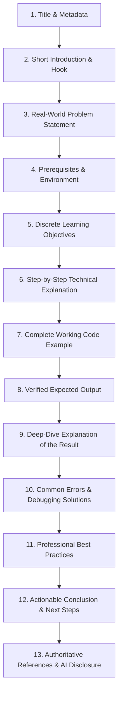

# CAPSTONE 62: Research Report
## AI-Powered Technical Blog Writing Series for Developers

**Project Title:** CAPSTONE 62 — AI-Powered Technical Blog Writing Series for Developers  
**Author:** Alex Chen (CSE Student Developer)  
**Academic Mentor / Reviewer:** Prof. Sarah Jenkins  
**Date:** October 15, 2026  
**Primary Research Question:** *How can AI help a student write clear, original, and accurate technical blog posts?*

---

## Executive Summary
For Computer Science Engineering (CSE) students, technical writing is a critical career multiplier. Publishing original, well-structured, and technically accurate blog posts allows students to build developer credibility, demonstrate domain mastery to prospective employers, and actively participate in the open-source community. However, beginner student writers face formidable hurdles: structural ambiguity, cognitive overload from technical jargon, untested code snippets, and poor editorial pacing.

The advent of Large Language Models (LLMs) provides unprecedented opportunities to assist students. Yet, unchecked reliance on AI poses severe technical and ethical hazards: code hallucinations, fabricated documentation citations, outdated APIs, and passive academic dishonesty.

This research report presents the foundational framework for **CAPSTONE 62**. It explores how AI tools—when paired with strict software engineering verification, human-in-the-loop oversight, and professional technical writing principles—empower CSE students to write clear, original, and technically verified developer content.

---

## 1. Target Audience & Student Context

### 1.1 Demographic Profile
The target audience consists of undergraduate and postgraduate Computer Science Engineering students who possess foundational programming skills (data types, loops, conditionals, basic data structures) but have limited experience writing public-facing technical prose.

### 1.2 Core Student Objectives
- **Demystify Complex Concepts:** Consolidate classroom theory into practical, hands-on software development knowledge.
- **Build an Authoritative GitHub Profile:** Accompany software repositories with polished, readable tutorials and documentation.
- **Establish Professional Communication:** Transition from fragmented academic assignments to industry-standard developer documentation.
- **Evaluate and Verify AI Outputs:** Develop critical fact-checking skills to detect hallucinations, invalid syntax, and deprecated methods before publication.
- **Maintain Ethical Writing Habits:** Create 100% original prose, credit sources accurately, and disclose AI assistance transparently.

---

## 2. Multi-Tool AI Ecosystem & Comparative Research

To ground this project in accessible workflows, we utilized free AI tools and tiers. Each tool serves a distinct role in the technical blogging pipeline:

| Tool | Tier / Access | Primary Role in Content Pipeline | Status in This Project |
|---|---|---|---|
| **Google Gemini / Antigravity** | Free / Integrated IDE | Technical synthesis, CLI architecture design, and automation script generation | **Completed & Utilized** |
| **ChatGPT (GPT-4o mini / Free Tier)** | Free Web Tier | Brainstorming alternative outlines, conceptual explanations, and prompt testing | **Completed & Utilized** |
| **Claude (Sonnet / Free Tier)** | Free Web Tier | Long-form editorial critique, paragraph coherence, and readability review | **Completed & Utilized** |
| **Grammarly Free** | Free Extension / App | Grammar, spelling, passive-to-active voice conversion, and sentence brevity | **Completed & Utilized** |
| **GitHub** | Free Developer Tier | Code repository hosting, automated testing (`unittest`), and version tracking | **Completed & Utilized** |
| **Notion / Local CSV Automation** | Free Tier / Python Engine | Content calendar tracking, deadline alerting, and verification gatekeeping | **Completed & Executed** |

### 2.1 Comparative AI Prompt Experiment
To evaluate how different AI models advise students on technical blog writing, we conducted a controlled side-by-side prompt experiment between **Google Gemini** and **ChatGPT (Free Tier)**.

#### Standardized Prompt Submitted to Both Models:
```text
"Act as a principal software engineer and technical editor. A 3rd-year computer science 
student wants to write a technical blog post explaining how to build a Command-Line 
Interface (CLI) application in Python. What structural advice, code architecture 
recommendations, and technical cautions should the student follow to make the post 
practical, accurate, and appealing to hiring managers?"
```

#### Detailed Findings & Comparison:

| Evaluation Dimension | Google Gemini Output | ChatGPT Output | Verification & Editorial Decision |
|---|---|---|---|
| **Structural Advice** | Emphasized architectural separation: isolated data persistence (`json`/`sqlite3`) from CLI parsing (`argparse`). Suggested a 10-point checklist. | Emphasized a compelling hook, storytelling ("Why build CLI tools in 2026?"), and clear step-by-step headers. | **Decision:** Merged both approaches. We adopted ChatGPT’s engaging narrative problem statement and Gemini’s modular technical structure. |
| **Code Architecture** | Strongly advised against third-party dependencies (e.g., `click` or `rich`) for beginner posts; recommended Python Standard Library (`argparse`, `json`, `sys`) to ensure zero-setup execution. | Suggested using `click` or `typer` for cleaner decorators, but acknowledged standard `argparse` as a fallback. | **Decision:** Chose standard library `argparse`. For students, eliminating `pip install` friction prevents environment configuration errors on readers' machines. |
| **Debugging & Error Guidance** | Specifically highlighted handling corrupted JSON files, non-integer IDs, and gracefully exiting via `sys.exit()` with stderr messages. | Recommended general try-except blocks and logging with the `logging` module. | **Decision:** Adopted Gemini’s specific stderr and corrupted-file recovery pattern in `task_manager.py` as it directly demonstrates production error handling. |
| **Verification & Testing Advice** | Recommended including automated `unittest` scripts alongside the blog to prove that the code actually runs. | Recommended providing reproducible CLI commands and expected terminal snapshots. | **Decision:** Implemented both: executable terminal commands in Post 1 and a dedicated unit testing article in Post 3. |

---

## 3. Part A: Principles of Technical Writing

Technical writing is distinct from academic essay writing or creative prose. Based on authoritative industry standards (Google Technical Writing courses and MDN Web Docs writing guidelines), our project implements twelve core principles:

1. **Know the Target Audience:**  
   Write specifically for a peer CSE student. Avoid assuming advanced system administration knowledge, but do not patronize readers by over-explaining standard programming primitives (e.g., variables, loops).
2. **Define the Learning Objective Upfront:**  
   State unambiguously in the introduction what concrete artifact the reader will build and understand by the end of the article.
3. **Use a Clear, Problem-Focused Title:**  
   Titles must clearly signal the technical topic and practical outcome (e.g., *"Build Your First Python CLI Application: A Step-by-Step Guide"* rather than *"Playing with Python Scripts"*).
4. **Start with a Practical Problem Statement:**  
   Establish immediate relevance by explaining the real-world engineering challenge before introducing code (e.g., managing context switching and tracking developer tasks without leaving the terminal).
5. **Organize Content with Strict Heading Hierarchies:**  
   Use semantic Markdown headers (`#`, `##`, `###`) to create a scannable outline. Readers should understand the tutorial flow simply by scanning headings.
6. **Explicitly Define Technical Terms:**  
   When introducing terms like *idempotent*, *serialization*, *traceback*, or *pure function*, define them in plain language upon first appearance.
7. **Use Short Paragraphs and Active Voice:**  
   Follow Google Developer Style Guide guidelines: limit paragraphs to 3–4 sentences focusing on a single conceptual thought. Use active voice ("Run the command..." instead of "The command should be run by you...").
8. **Include Accurate, Complete Code Examples:**  
   Avoid lazy pseudocode or snippets truncated with `# code goes here`. Provide functional, syntactically verified code snippets that readers can copy and execute directly.
9. **Provide Real Expected Outputs:**  
   Every code snippet must be paired with the exact terminal output or return value produced when executed. This allows the reader to confirm intermediate success.
10. **Explain Errors and Practical Debugging:**  
    Anticipate where beginners stumble (e.g., missing colons, type mismatch, index bounds). Explain why the error occurs and how to interpret the traceback.
11. **Link Directly to Authoritative References:**  
    Anchor explanations in official documentation (e.g., Python.org, MDN, GitHub Docs) rather than unverified secondary forums.
12. **End with a Summary and Concrete Next Steps:**  
    Recap what was learned and challenge the reader with realistic extension exercises to solidify their comprehension.

---

## 4. Part B: Developer Blog Structure

To ensure consistency across the series, each post conforms to a standardized 13-stage developer blog structure:



### Purpose of Each Structural Component:
1. **Title:** Sets clear technical expectations and includes target keywords.
2. **Short Introduction:** Welcomes the reader and establishes why the subject matters today.
3. **Problem Statement:** Explains the inefficiency or obstacle that the tutorial overcomes.
4. **Prerequisites:** Informs the reader of required knowledge and software versions (e.g., Python 3.10+).
5. **Learning Objectives:** Bulleted outcomes describing tangible skills acquired.
6. **Step-by-Step Explanation:** Deconstructs the concept from architecture to implementation.
7. **Code Example:** Complete, functional script demonstrating clean syntax and comments.
8. **Expected Output:** Verbatim terminal or console output for verification.
9. **Explanation of Result:** Connects the code logic directly to the visible output.
10. **Common Errors & Solutions:** Prevents beginner drop-off by pre-solving common bugs.
11. **Best Practices:** Elevates the code to production standards (validation, modularity).
12. **Conclusion:** Summarizes key milestones and suggests creative portfolio extensions.
13. **References & AI Disclosure:** Attributes official sources and transparently declares AI assistance.

---

## 5. Part C: Reliable Sources & Verification Methodology

### 5.1 Authoritative Source Selection Criteria
In technical writing, source quality directly determines credibility. We adopted strict criteria:
- **Primary Documentation First:** Official documentation (Python.org, MDN, GitHub) takes precedence over all third-party tutorials.
- **Official Style Standards:** Google Developer Documentation Style Guide serves as the benchmark for grammatical clarity and terminology.
- **Plagiarism Prevention:** Popular blogs (Real Python, Dev.to, Medium) were reviewed solely for pedagogical pacing and heading design. Zero text, architecture, or code was duplicated.

### 5.2 Source Verification Register
*(Complete details available in [`capstone-62/research/references.md`](file:///c:/Users/yohes/OneDrive/Desktop/44/capstone-62/research/references.md))*
- **Python 3.12 Standard Library Docs:** Verified all `argparse`, `json`, and `unittest` APIs against the active interpreter.
- **Google Developer Style Guide:** Applied active voice and second-person pronouns across all articles.
- **Python Exceptions Reference:** Verified exact exception names and traceback formats for Post 2.

---

## 6. How AI Enhances the Student Technical Writing Process
Returning to our core research question: *How can AI help a student write clear, original, and accurate technical blog posts?*

Our investigation reveals four high-leverage domains where AI acts as a cognitive booster:
1. **Overcoming the "Blank Page" Paralysis:** AI helps students generate multiple structured outlines from raw assignment ideas, allowing them to choose the most logical pedagogical flow.
2. **Interactive Code Review and Edge Case Identification:** AI can analyze a student's code and suggest edge cases that might cause crashes (e.g., non-existent JSON files or negative IDs), which the student can then address and explain in their blog.
3. **Translating Complex Jargon into Accessible Analogies:** Students can prompt AI to critique explanations from the perspective of a beginner, identifying where terms need clearer definitions.
4. **Drafting Educational Traceback Explanations:** AI excels at generating realistic traceback walkthroughs that help students explain *why* an error occurred rather than just showing a fix.

**Crucial Caveat:** AI cannot substitute for running the code. A student must execute every command, verify every output, and write the final explanations in their own voice to guarantee authenticity and accuracy.
